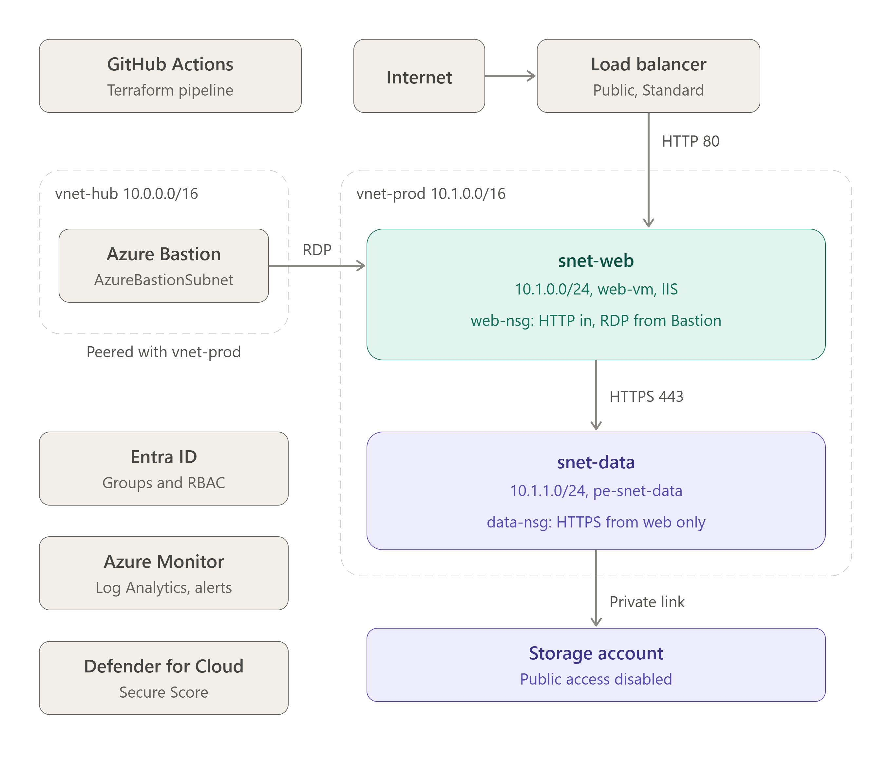
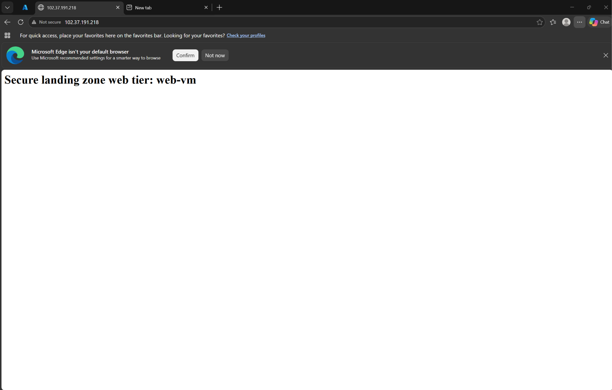
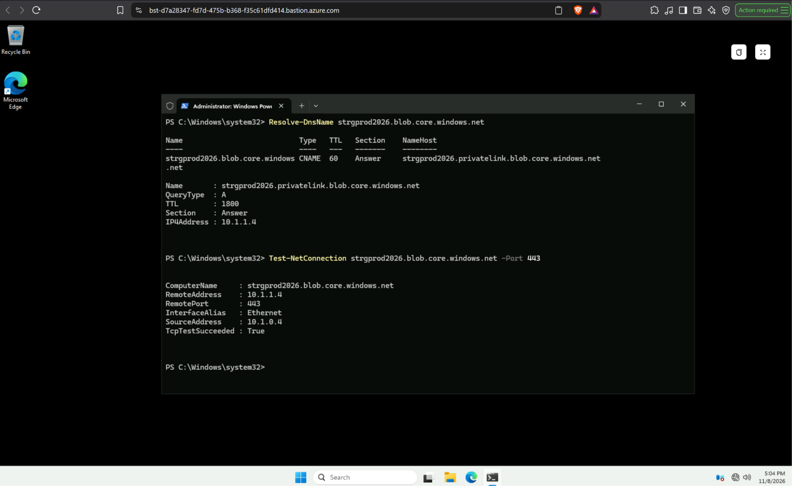
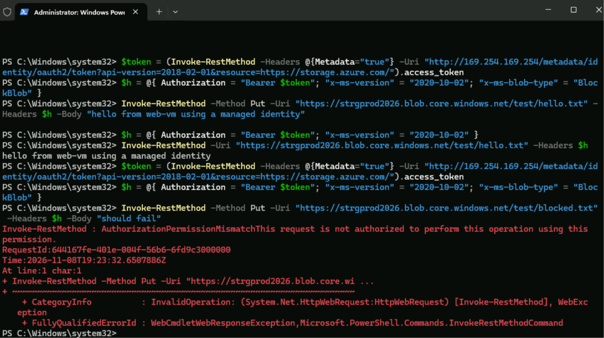

# Secure Azure Landing Zone

A small Azure environment I built to practise AZ-104 skills. It has a hub and spoke network, a web server behind a load balancer, storage that can only be reached privately, and identity controls. I documented everything so anyone can follow what I did and why.

## The problem

A healthcare company needs an Azure environment that controls who has access, keeps sensitive data off the public internet, watches for unusual activity, and can be rebuilt the same way every time.

## Architecture

Visitors reach a public load balancer, which sends traffic to the web VM in the web subnet. The web VM talks to storage through a private endpoint in the data subnet. I manage the VM only through Azure Bastion, so no admin ports are open to the internet.

## What I built

| Area | What is in it |
|---|---|
| Network | Hub and spoke virtual networks with peering, and a network security group on each subnet |
| Access | Azure Bastion in the hub. The VM has no public IP |
| Web server | A Windows Server 2022 VM running IIS, behind a Standard load balancer |
| Data | A storage account with public access turned off, a private endpoint and a private DNS zone |
| Identity | Security groups, role assignments at resource group level, and a managed identity on the VM |
| Monitoring | Add this row if you finished it |
| Automation | Add this row if you finished it |

## Why I made these choices

- Hub and spoke keeps admin access in one place and keeps workloads separate from it.
- Bastion means I never open RDP to the internet.
- The private endpoint keeps storage off the public internet. Inside the network, the storage name points to a private IP.
- The VM uses a managed identity instead of storage keys, and shared key access is turned off.
- The data subnet only accepts HTTPS from the web subnet and blocks everything else.

The full reasoning and screenshots are in [docs/decisions.md](docs/decisions.md).

## Screenshots

## Security

- No VM has a public IP.
- Storage has public network access off, anonymous access off and a minimum of TLS 1.2.
- Access goes to groups, with the smallest role that does the job.
- Add monitoring and alert rules here if you finished them.

## What I would change for production

- Application Gateway with a web application firewall and HTTPS
- Azure Firewall in the hub
- Key Vault for secrets and Azure Policy to enforce standards
- Diagnostic logs on every resource, sent to one workspace, with Microsoft Sentinel on top
- PIM and Conditional Access with MFA
- Zone redundant VMs and separate subscriptions for production and testing

## Limits of this lab

- PIM and Conditional Access need Entra ID P2 and P1 licences. My tenant did not have them after the trial ended, so I documented the design but did not build it.
- It uses plain HTTP and one VM to keep the cost down.

## How to deploy

Describe how someone could rebuild it. If you finished Terraform, list the steps to run it. If you built it by hand, say so and point to docs/decisions.md for the steps and scripts/install-iis.ps1 for the web server install.

## Cost and clean up

The load balancer, Bastion, VM and private endpoint are billed by the hour. When I am not using them I stop the VM and delete Bastion. To remove everything, delete the resource groups rg-prod and rg-hub. Keep rg-tfstate if you use remote state.

## About me

David Tshitenda
www.linkedin.com/in/david-tshitenda-75a20a141