## Phase 1: Hub and spoke network

- **Decision:** A hub and spoke layout. `vnet-hub` holds Azure Bastion, and `vnet-prod` is the production spoke with `snet-web` and `snet-data`. The two are connected by VNet peering.
- **Why:** The hub keeps admin access in one place, and the spoke keeps workloads separate from it. More spokes can be added later without changing the hub.
- **Alternative considered:** One flat VNet. Rejected because every workload would share the same network and the same rules.
- **Trade-off:** More resources to manage. Peering does not pass traffic on, so spokes can't talk to each other unless the traffic is routed through the hub.

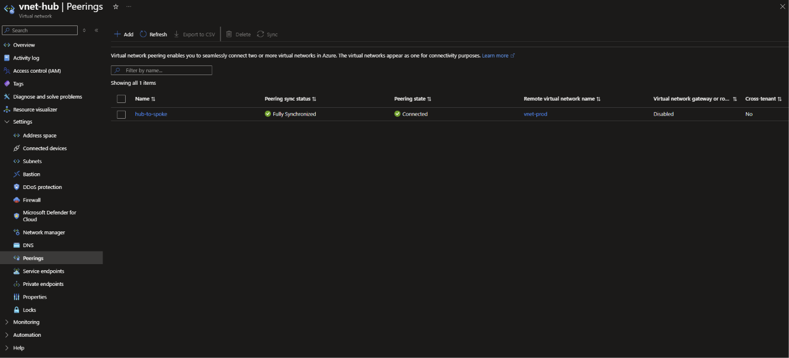

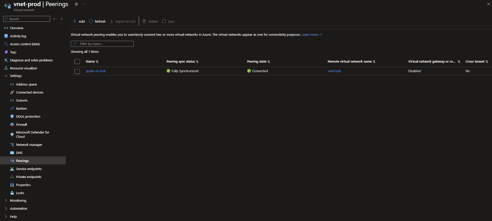

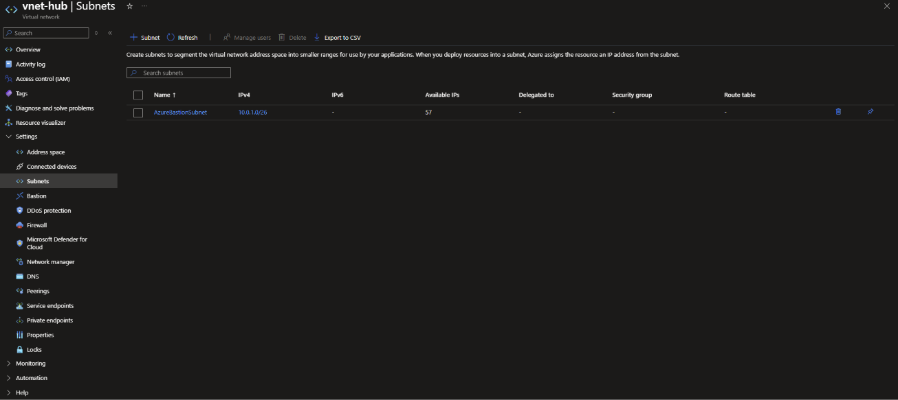

### Network security groups

- **Decision:** One NSG per subnet, with inbound traffic denied by default. `web-nsg` on `snet-web` allows HTTP from the internet and allows management traffic only from the Bastion subnet. A Standard load balancer passes client traffic straight through, so the NSG sees the visitor's own IP address.
- **Why:** Each subnet only gets the access it needs, and no management ports are open to the internet.
- **Alternative considered:** Public IPs on the VMs with RDP or SSH limited to my own IP. Rejected because it still leaves a management port open to the internet.
- **Trade-off:** Rules need maintaining, and a mistake can block traffic that should get through. Each rule has a clear name so it is easy to review.
- **Data subnet:** `data-nsg` allows HTTPS (443) only from `snet-web`, with a deny rule for everything else at priority 4096. Azure's default AllowVnetInBound rule would otherwise let any traffic from inside the VNet or the peered hub reach it.
- **Private endpoint policy:** Set to Network security groups on `snet-data`, so the NSG rules apply to private endpoint traffic. With the default (Disabled), NSGs are ignored for private endpoints.
- **Private subnet:** `snet-data` has default outbound access turned off, so nothing in the data subnet can start a connection to the internet.

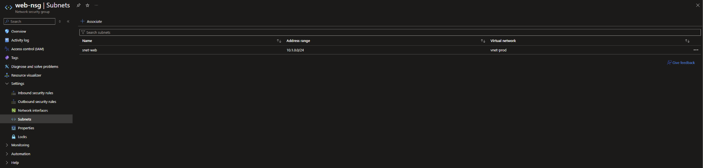

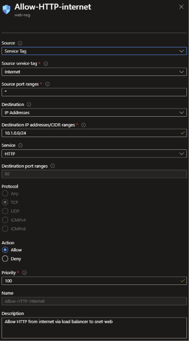

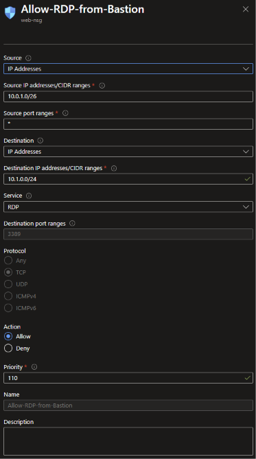

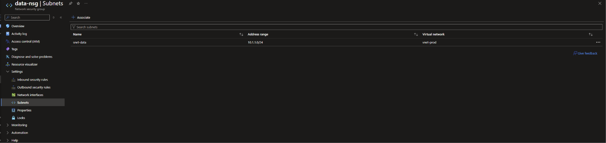

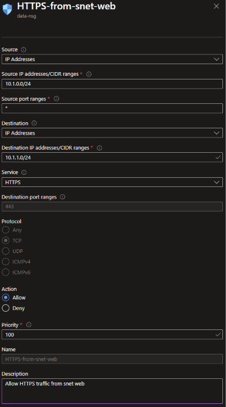

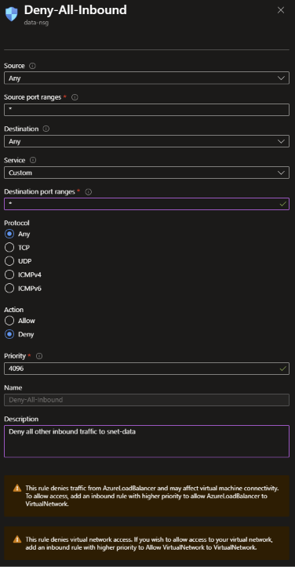

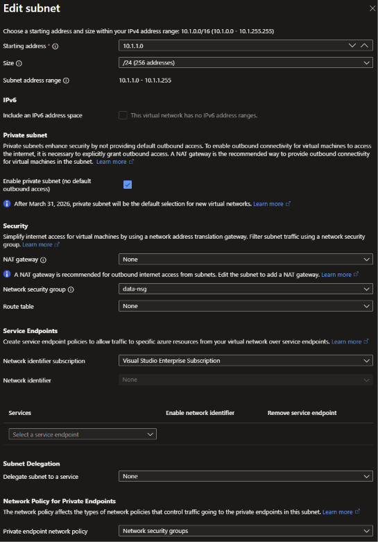

## Phase 2: Web server, Bastion and load balancer

- **Decision:** A Windows Server web VM (`web-vm`) in `snet-web` with no public IP, behind a Standard public load balancer (`lbe-web-prod`). I manage the VM only through Azure Bastion.
- **Why:** The VM has no public IP and no open management port. The load balancer is the only public entry point and only sends traffic to healthy instances.
- **Alternative considered:** A public IP on the VM with RDP limited to my own address. Rejected because it still leaves a management port open to the internet.
- **Trade-off:** A Standard load balancer and Bastion are billed by the hour. The load balancer works at layer 4 only, with no web application firewall or HTTPS handling, so traffic is plain HTTP in this lab. For production I would use Application Gateway with a WAF and HTTPS.
- **Provisioning:** IIS was installed with Run Command from `scripts/install-iis.ps1`, which does not need outbound internet access.
- **Troubleshooting note:** I redeployed the VM once and had to install IIS again. Keeping the install in a script means I can run it again in seconds.

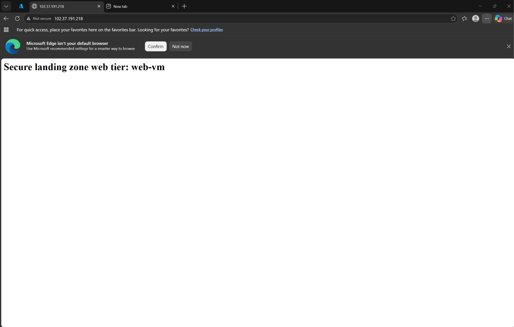

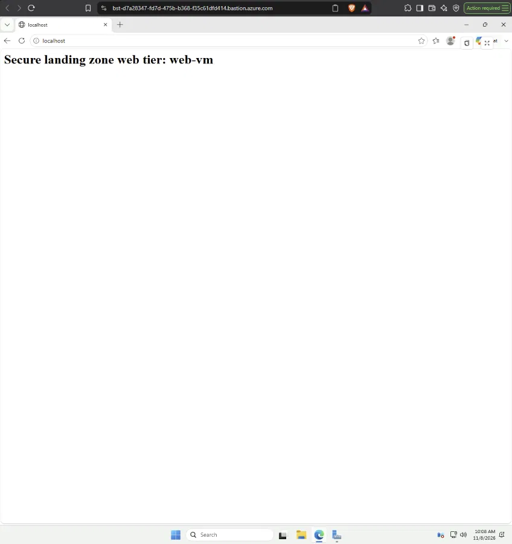

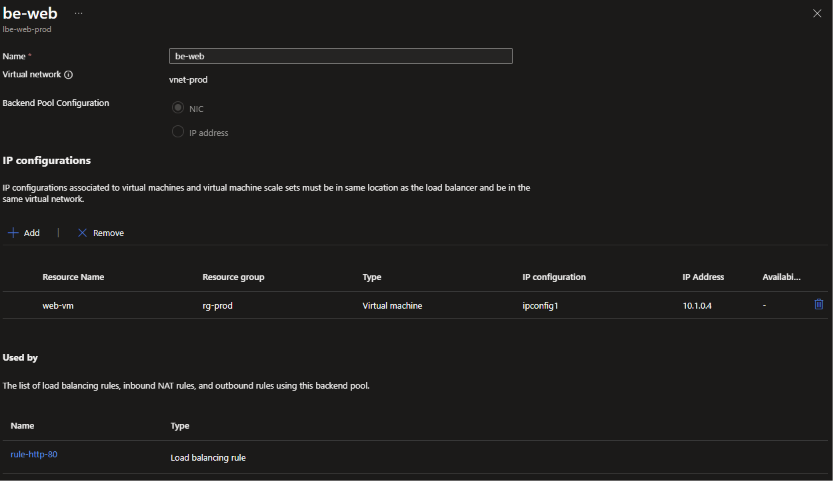

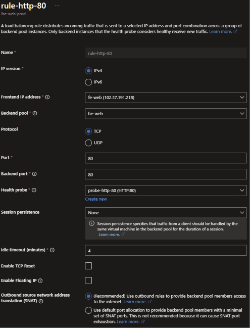

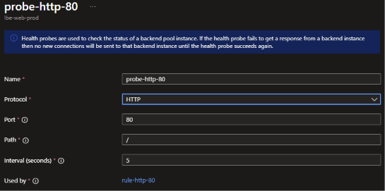

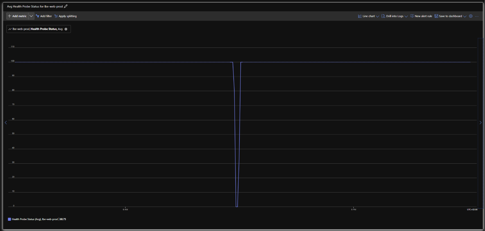

## Phase 3: Storage with a private endpoint

- **Decision:** The storage account (`strgprod2026`) has public network access turned off and can only be reached through a blob private endpoint (`pe-snet-data`) in `snet-data`. The `privatelink.blob.core.windows.net` private DNS zone is linked to both VNets.
- **Why:** The data can't be reached from the internet. Inside the network, the storage name points to a private IP (`10.1.1.4`) and traffic stays on Microsoft's own network.
- **Alternative considered:** A service endpoint with a firewall rule. Rejected because the storage account keeps its public address and the traffic is not sent to a private IP.
- **Trade-off:** The private endpoint and DNS zone add cost and extra pieces to manage. Without the private DNS zone and the VNet links, the name would point to the public address and access would fail.
- **Verification:** From `web-vm`, DNS follows the privatelink name to a private address and TCP 443 succeeds. From my own computer, the name points to a public address and access is refused.
- **Hardening:** Anonymous blob access is off, secure transfer is required and the minimum TLS version is 1.2. Shared key access was turned off later, once the managed identity worked.

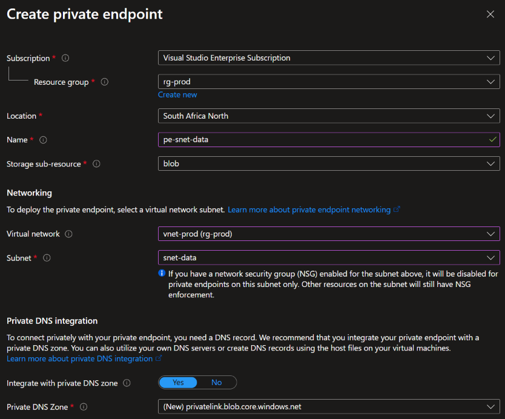

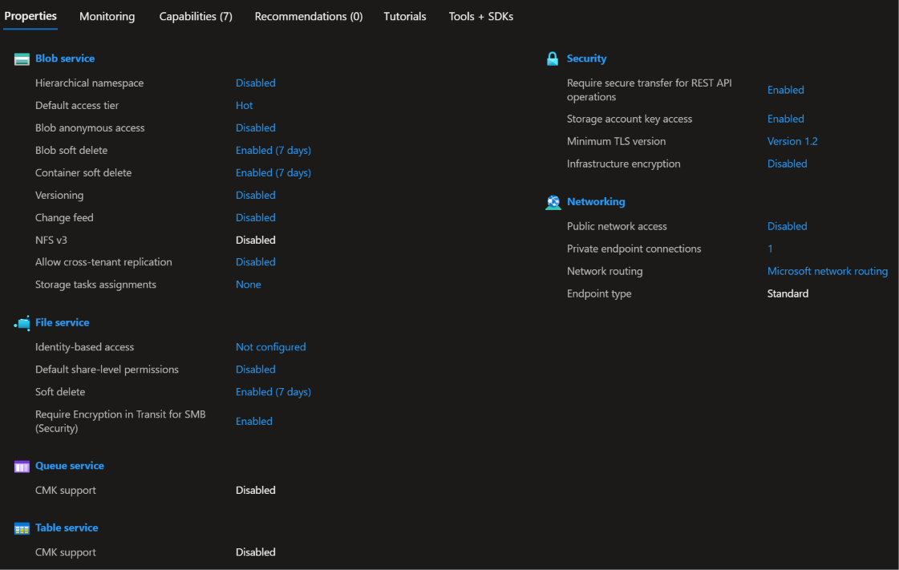

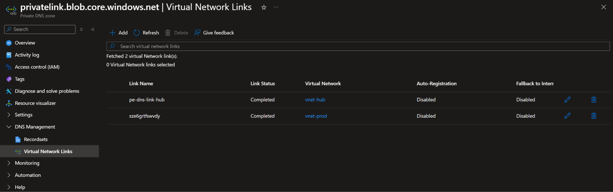

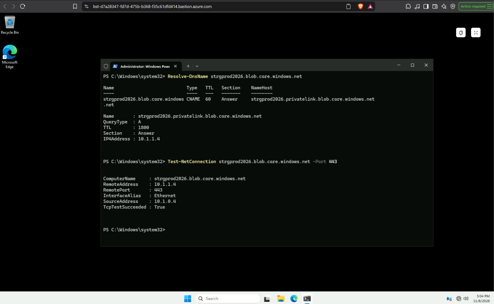

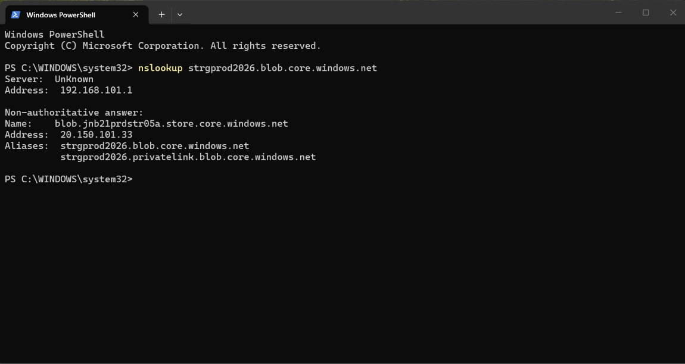

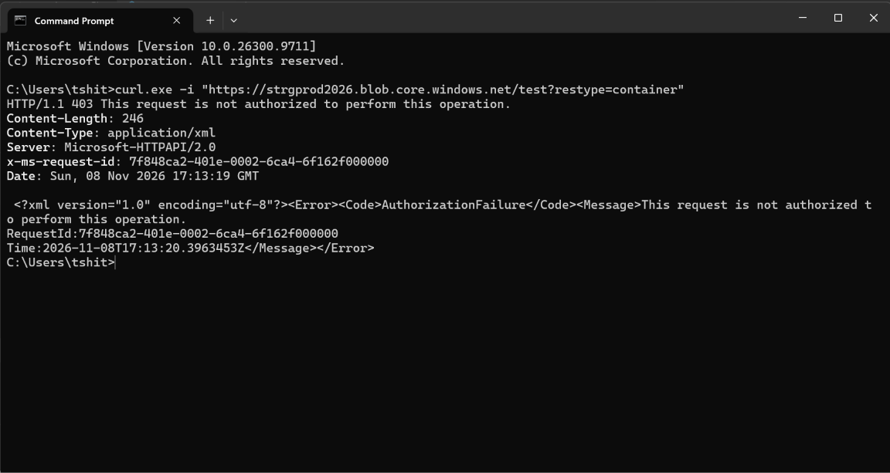

## Phase 4: Identity and access

- **Decision:** Azure roles go to security groups at resource group or resource level. `sg-readers` has Reader, `sg-cloud-admins` has Contributor on `rg-prod` with no standing members, and the web VM's managed identity has Storage Blob Data Reader on the storage account.
- **Why:** Groups are easy to review and change, narrow scopes limit the damage if something goes wrong, and the managed identity removes keys and connection strings.
- **Alternative considered:** Giving roles to individual users and using storage account keys. Rejected because it doesn't scale and keys can leak.
- **Trade-off:** More groups and assignments to look after. Without PIM, admin access is a standing assignment and not something that is switched on when needed.
- **Managed identity test:** From `web-vm`, a token from the instance metadata service reads a blob over the private endpoint with no keys. With only Storage Blob Data Reader, reads work and writes return 403. I then turned off shared key access and reads still worked, which shows nothing depends on keys.
- **Privileged access:** PIM (Privileged Identity Management) needs Entra ID P2, which my tenant did not have after the trial ended. Instead, `sg-cloud-admins` has no standing members and membership changes show in the Azure Activity log. For production I would make Contributor eligible through PIM, with MFA when it is switched on, a reason, a short time limit and approval for sensitive roles.
- **MFA and legacy sign in:** The tenant is on Entra ID Free, so Conditional Access isn't available. I turned on security defaults instead, which require MFA for administrators and Azure management and block legacy authentication. For production I would use Conditional Access, starting in report-only mode with the emergency account excluded.
- **Emergency access:** A cloud-only Global Administrator account on the .onmicrosoft.com domain, protected with Microsoft Authenticator and a synced passkey. Its credentials are kept offline and it is not used day to day. Security defaults don't allow exclusions, so MFA still applies. For production I would use two accounts with hardware security keys stored separately, exclude them from Conditional Access and alert on every sign in.

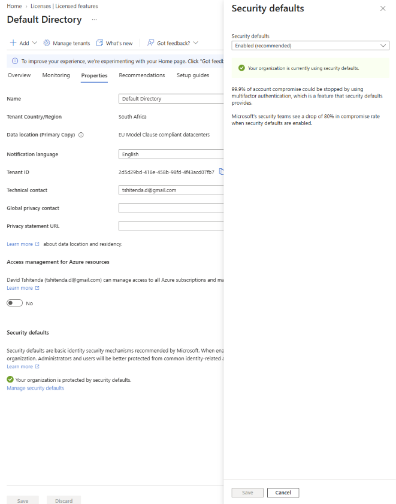

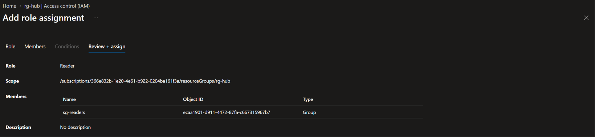

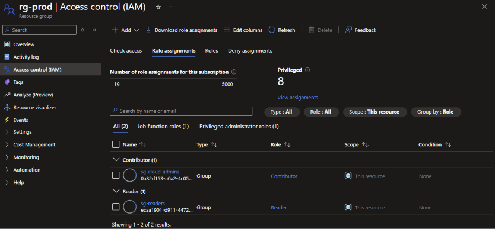

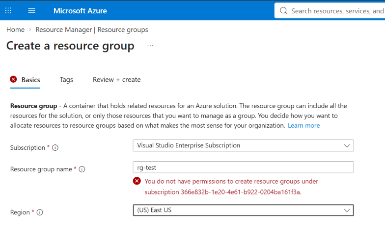

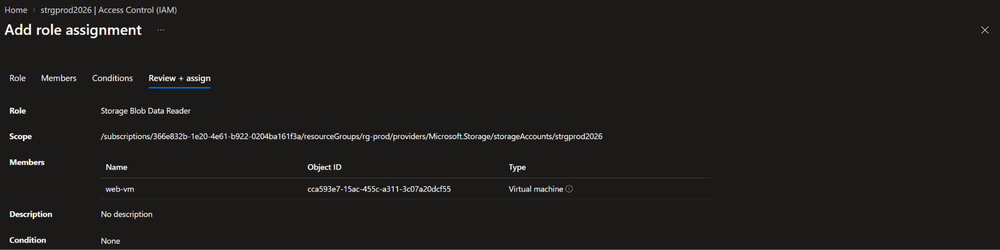

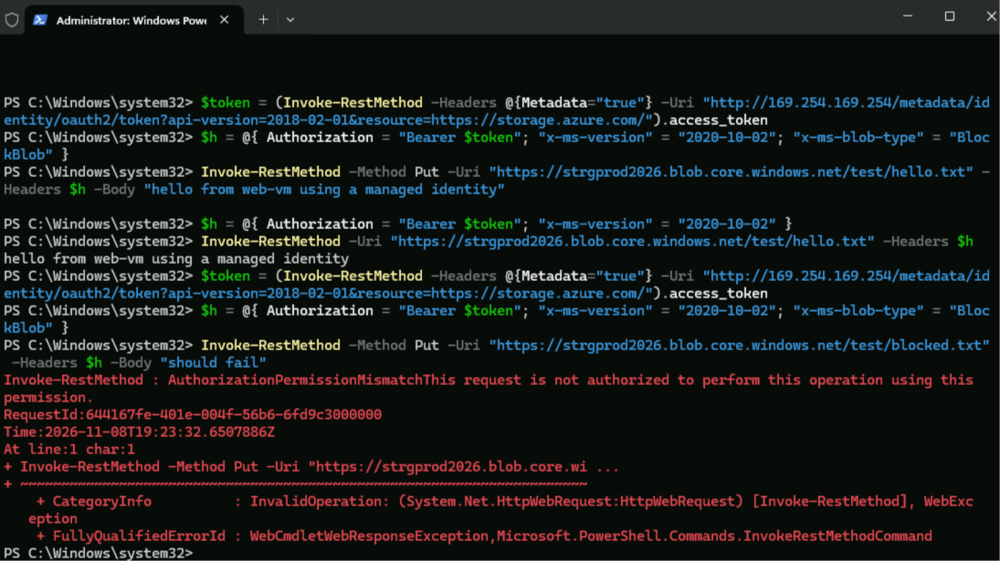

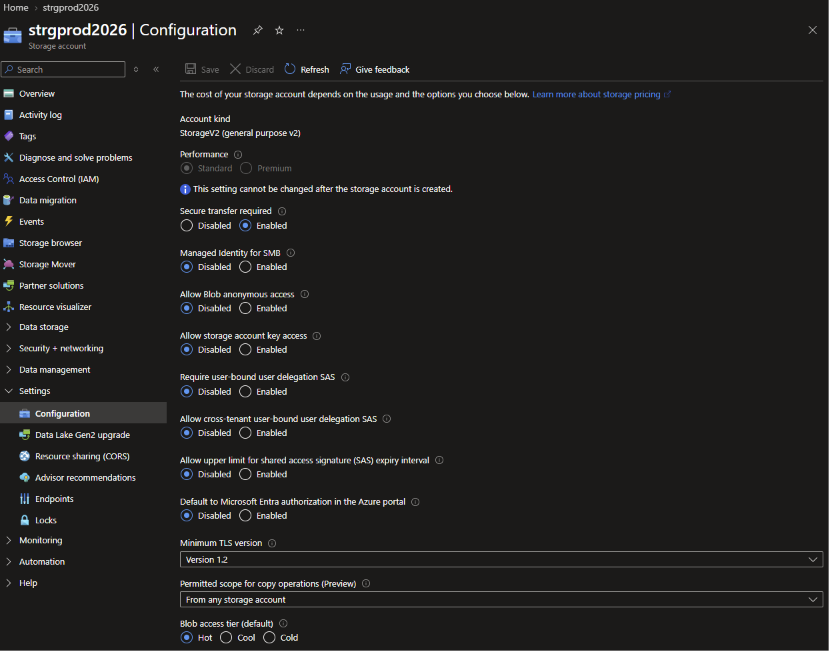

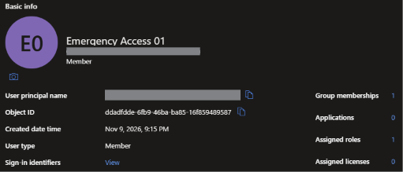

## Phase 5: Monitoring and alerts

- **Decision:** The Azure Monitor Agent on `web-vm` sends failed logon events (Security event 4625) to a Log Analytics workspace through a data collection rule. The Azure Activity log and the Entra sign in and audit logs go to the same workspace.
- **Why:** One workspace gives me a single place to search and alert on identity, network and data activity.
- **Alternative considered:** Leaving the logs in each service. Rejected because I could not search or alert across them.
- **Trade-off:** Log ingestion is billed by volume, so I collect only failed logons and not every security event.
- **Outbound access:** The VM has no public IP, so the agent could not reach Azure Monitor until I added an outbound rule on the load balancer. For production I would use a NAT gateway or Azure Firewall.
- **Alerts:** Failed logons above five in ten minutes, any role assignment change, and any refused or anonymous request to storage. They all go to an action group that emails me and calls a Logic App.
- **Storage alert:** Blob read, write and delete logs go to the workspace, and an alert fires on any request refused with a 401 or 403 or made anonymously. With public network access turned off, most outside requests never reach storage, so this watches for attempts that get past the network or misuse from inside it.
- **Notification:** The Logic App formats the alert and sends the email, so I can change the response later without editing each alert.
- **Limit:** PIM activation logs need Entra ID P2, so access changes are tracked through the Azure Activity log instead.

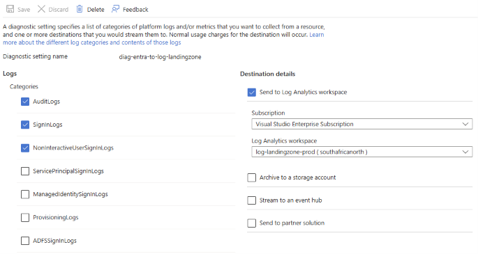

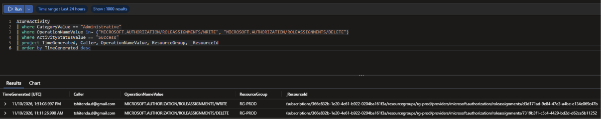

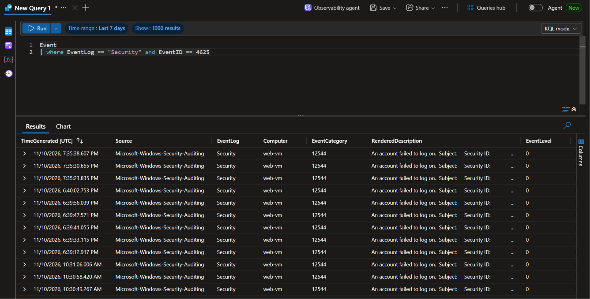

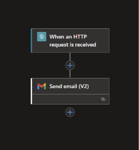

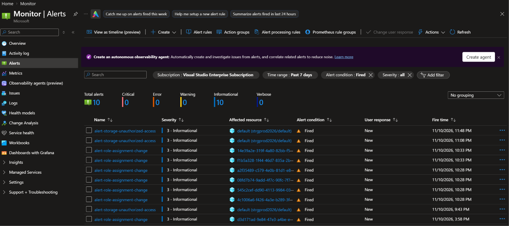

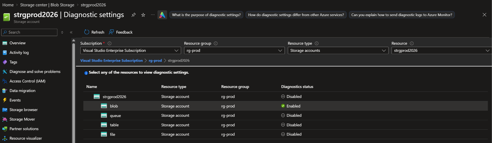

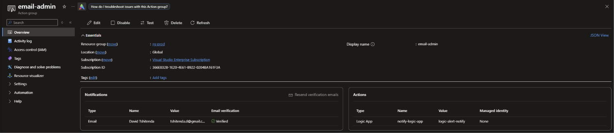

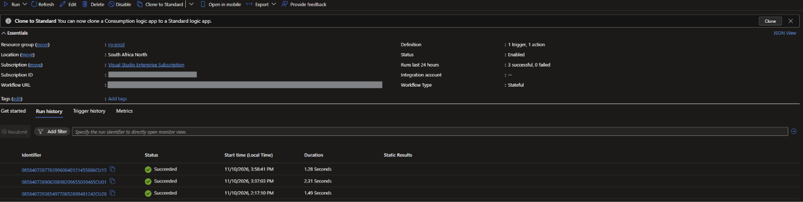

## Phase 6: Security review

- **Decision:** Defender for Cloud reviewed the subscription and flagged 35 recommendations. I fixed four that fit the project and left the rest as a list for later.
- **Fixed:** Email notifications for high severity alerts, Defender for Resource Manager, periodic checks for missing system updates, and an outdated OpenSSL on `web-vm`.
- **OpenSSL:** I found the outdated file belonged to the Azure Monitor Agent, so I did not replace it by hand. I ran Windows Update and turned on automatic updates on the VM and in the portal so the agent stays current.
- **Result:** The Secure Score went from 61% to 76%.
- **Trade-off:** Defender for Resource Manager is a paid plan, so it uses up my credit while it is on and was turned off to prevent credit spend.
- **Not done:** The other recommendations, and paid plans such as Defender for Servers. For production I would sort them by severity and turn the plans on for the VMs and storage.

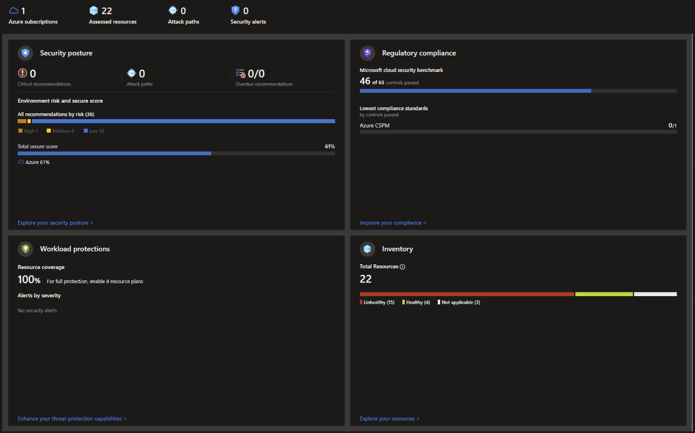

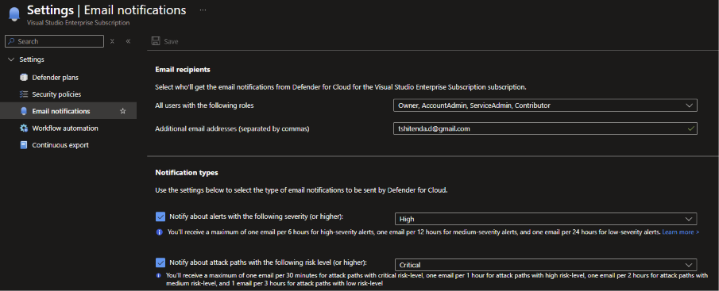

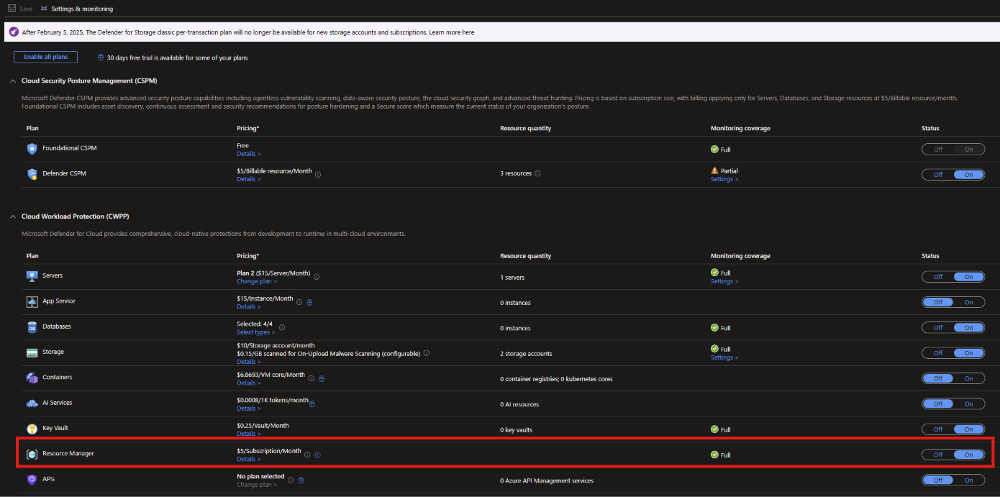

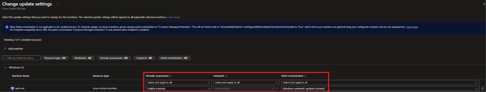

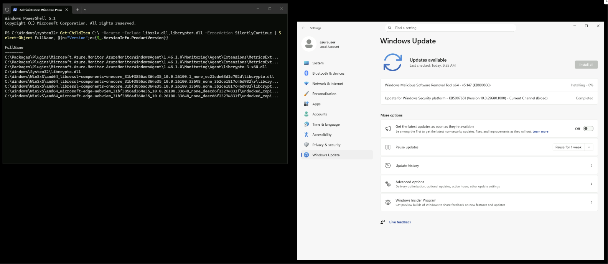

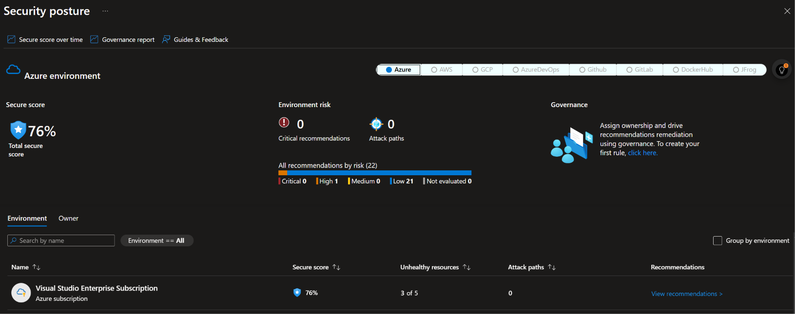