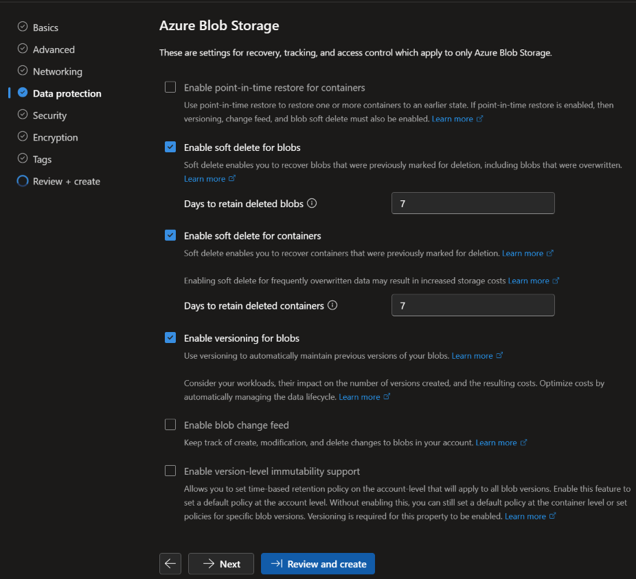

## Phase 1: Remote state storage

- **Decision:** Terraform state lives in a separate storage account with versioning enabled.
- **Why:** State is the source of truth for the environment. A separate account means destroying the lab does not destroy the state, and versioning lets me recover from a bad apply or a corrupted file.
- **Alternative considered:** Local state on my laptop. Rejected because it cannot be shared with a pipeline and is lost if the machine fails.
- **Trade-off:** One extra resource to pay for and protect, which I locked against deletion.

## Phase 2: Hub and spoke network

- **Decision:** Hub and spoke topology. `vnet-hub` holds Azure Bastion, and `vnet-prod` is the production spoke with `snet-web` and `snet-data`. The two are connected by VNet peering.
- **Why:** The hub centralises access, and the spoke isolates workloads. More spokes can be added later without changing the hub.
- **Alternative considered:** A single flat VNet. Rejected because every workload would share one network boundary and one set of rules.
- **Trade-off:** More resources to manage. Peering is not transitive, so spokes can't talk to each other unless traffic is routed through the hub.

### NSG design

- **Decision:** One NSG per subnet, with default deny inbound. `web-nsg` on `snet-web` allows HTTP from the internet (a Standard load balancer passes client traffic through, so the NSG sees the original client IP) and allows management traffic only from the Bastion subnet.
- **Why:** Least privilege at the subnet boundary, with no management ports exposed to the internet.
- **Alternative considered:** Public IPs on the VMs with RDP or SSH restricted to my own IP. Rejected because it still exposes a management port to the internet.
- **Trade-off:** Rules need maintaining, and a mistake can block legitimate traffic. Each rule has a clear name so it can be audited.
- **Data tier:** `data-nsg` allows HTTPS (443) only from `snet-web`, with an explicit deny-all at priority 4096. Azure's default AllowVnetInBound rule would otherwise permit any traffic from inside the VNet or from the peered hub.
- **Private endpoint policy:** Set to Network security groups on `snet-data`, so NSG rules apply to private endpoint traffic. The default (Disabled) ignores NSGs for private endpoints.
- **Private subnet:** `snet-data` has default outbound access disabled, so nothing in the data tier can initiate connections to the internet.

## Phase 3: Compute, Bastion and load balancer

- **Decision:** A Windows Server web VM (`web-vm`) in `snet-web` with no public IP, behind a Standard public load balancer (`lbe-web-prod`). Administration is only through Azure Bastion.
- **Why:** No public IP or open management port on the VM. The load balancer is the single public entry point and routes only to healthy instances.
- **Alternative considered:** A public IP on the VM with RDP restricted to my own address. Rejected because it still exposes a management port to the internet.
- **Trade-off:** A Standard load balancer and Bastion bill hourly. The load balancer works at layer 4 only, with no WAF or TLS termination, so traffic is plain HTTP in this lab. At production scale I'd use Application Gateway with a WAF and HTTPS.
- **Provisioning:** IIS was installed with Run Command from `scripts/install-iis.ps1`, which needs no outbound internet access. Terraform will run the same script in Phase 8.
- **Troubleshooting note:** The VM was redeployed once, and IIS had to be installed again. Scripting the install avoids that kind of drift.

## Phase 4: Storage with private endpoint

- **Decision:** The storage account (`strgprod2026`) has public network access disabled and is reachable only through a blob private endpoint (`pe-snet-data`) in `snet-data`. The `privatelink.blob.core.windows.net` private DNS zone is linked to both VNets.
- **Why:** Data is unreachable from the internet. Inside the network, the storage name resolves to a private IP (`10.1.1.4`) and traffic stays on the Azure backbone.
- **Alternative considered:** A service endpoint with a firewall rule. Rejected because the storage account keeps a public endpoint and the traffic is not addressed privately.
- **Trade-off:** The private endpoint and DNS zone add cost and moving parts. Without the private DNS zone and VNet links, the name would resolve to the public address and access would fail.
- **Verification:** From `web-vm`, DNS resolves through the privatelink CNAME to a private address and TCP 443 succeeds. From my own computer, the name resolves to a public address and access is refused.
- **Hardening:** Anonymous blob access is disabled, secure transfer is required, and the minimum TLS version is 1.2. Shared key access is still enabled and will be disabled in Phase 5 once the managed identity works.

## Phase 5: Identity and access

- **Decision:** Azure roles are assigned to security groups at resource group or resource scope. `sg-readers` has Reader, `sg-cloud-admins` has Contributor on `rg-prod` with no standing members, and the web VM's managed identity has Storage Blob Data Reader on the storage account.
- **Why:** Groups make access easy to audit and change, narrow scopes limit the blast radius, and the managed identity removes keys and connection strings.
- **Alternative considered:** Assigning roles to individual users and using storage account keys. Rejected because it doesn't scale and secrets can leak.
- **Trade-off:** More groups and assignments to maintain. Without PIM, admin access is a standing assignment rather than an activation step.
- **Managed identity test:** From `web-vm`, a token from the instance metadata service reads a blob over the private endpoint with no keys. With only Storage Blob Data Reader, reads succeed and writes return 403. Shared key access was then disabled, and reads still work, which shows nothing depends on secrets.
- **Privileged access:** PIM requires Entra ID P2, which wasn't available in this tenant after the trial ended. Instead, `sg-cloud-admins` has no standing members and membership changes are visible in the Azure Activity log. At production scale I would make Contributor eligible through PIM, with MFA on activation, a justification, a short duration and approval for sensitive roles.
- **MFA and legacy authentication:** The tenant is on Entra ID Free, so Conditional Access isn't available. Security defaults are enabled instead, which require MFA for administrators and Azure management and block legacy authentication. At production scale I would use Conditional Access in report-only mode first, with a break-glass account excluded, and PIM for just-in-time admin roles.
- **Emergency access:** A cloud-only Global Administrator account on the .onmicrosoft.com domain, protected with Microsoft Authenticator and a synced passkey. Its credentials are kept offline and it is not used day to day. Security defaults do not allow exclusions, so MFA still applies. At production scale I would use two accounts with device-bound FIDO2 hardware keys stored separately, exclude them from Conditional Access, and alert on every sign-in.

## Phase 6: Monitoring and detection

- **Decision:** The Azure Monitor Agent on `web-vm` sends failed logon events (Security event 4625) to a Log Analytics workspace through a data collection rule. The Azure Activity log and the Entra sign-in and audit logs go to the same workspace.
- **Why:** One workspace gives me a single place to query and alert on identity, network and data activity.
- **Alternative considered:** Leaving logs in each service. Rejected because I could not search or alert across them.
- **Trade-off:** Log ingestion is billed by volume, so I collect only failed logons and not every security event.
- **Outbound access:** The VM has no public IP, so the agent could not reach Azure Monitor until I added an outbound rule on the load balancer. At production scale I would use a NAT gateway or Azure Firewall.
- **Alerts:** Failed logons above five in ten minutes, any role assignment change, and any storage read from a non private address. They all go to an action group that emails me and calls a Logic App.
- **Notification:** The Logic App formats the alert and sends the email, so I can change the response later without editing each alert.
- **Limit:** PIM activation logs need Entra ID P2, so access changes are audited through the Azure Activity log instead.
- **Storage alert:** Blob read, write and delete logs go to the workspace, and an alert fires on any request refused with a 401 or 403 or made anonymously. With public network access disabled, most outside requests never reach storage, so this watches for attempts that get past the network layer or misuse from inside the network.

## Phase 7: Security Posture
